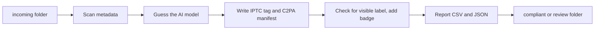

# Meta Tag Pipeline

A command line tool that checks AI generated product images and videos for the labelling the EU AI Act asks for (Article 50) and adds whatever is missing, both in the metadata and as a visible badge. Built for the team that publishes product media to online shops.

## Why

When product photos or clips are made with AI tools, they should be marked as such. Some tools write that information into the file, some do not, and nobody wants to check hundreds of files by hand before an upload. This tool scans a folder, tells you which files are fully marked, partly marked or not marked, fixes what it can, and sorts the files so a person only looks at the problem cases.

## How it works



1. `metadata_reader.py` reads EXIF, IPTC and XMP with `exiftool`, video info with `ffprobe` and any C2PA manifest with `c2patool`. The result is one of three states: fully marked, partly marked, not marked.
2. `model_detection.py` looks for known generator names (Midjourney, Firefly, Sora and so on) in the metadata. This is a text match, so it is a guess. New names go into `MODEL_SIGNATURES` in `config.py`.
3. `metadata_writer.py` sets the IPTC "Digital Source Type" and embeds a signed C2PA manifest.
4. `visible_label.py` runs OCR (Tesseract) on the four image corners, or on the first video frame, to see whether a text label is already there. If not, it overlays a badge (Pillow for images, `ffmpeg` for videos).
5. `report.py` writes `report.csv` and `report.json`. `file_router.py` moves files to `compliant/` or `review/`. One broken file never stops the batch.

Supported types: `.jpg`, `.jpeg`, `.png`, `.webp`, `.mp4`, `.mov`.

## Stack

Python 3, Pillow, pytesseract, and the external tools `exiftool`, `ffmpeg`, `c2patool`, `tesseract` and `openssl`. The `examples/` folder has ways to run it on a schedule or on a Drive folder (cron, a Drive webhook, a Google Apps Script). `google_apps_script/` contains a Drive only variant that writes the XMP field into JPEGs on the byte level.

## Run it

```bash
# external tools, e.g. on macOS
brew install exiftool ffmpeg tesseract
# c2patool: download from its GitHub releases

python3 -m venv venv
source venv/bin/activate
pip install -r requirements.txt

python -m ai_act_labeler.cli --input ./incoming --output ./processed
```

| Option | Meaning | Default |
|---|---|---|
| `--input` | Folder to scan, searched recursively | required |
| `--output` | Gets `compliant/`, `review/`, `report.csv`, `report.json` | required |
| `--badge` | Your own badge PNG with transparency | generated default |
| `--badge-position` | `bottom-right`, `bottom-left`, `top-right`, `top-left` | `bottom-right` |
| `--cert`, `--key` | Your own C2PA signing certificate and key (PEM) | local test certificate |
| `--alg` | `es256` for EC keys, `ps256` for RSA keys | `es256` |

Files in `review/` have an error or an unsupported type, the reason is in the report.

Without `--cert` and `--key` the tool creates a self signed test certificate under `~/.ai_act_labeler/test_cert/`. That is enough to test the workflow, but no Content Credentials viewer will trust it. For real use you need a certificate from a recognised authority.

For the Apps Script variant, see `google_apps_script/README.md`: copy the files into a project, enable the Drive API service, set `CONFIG.SOURCE_FOLDER_ID`, run `runManually` once for the permissions and `createTimeTrigger` once for the polling trigger. It only handles JPEG and writes no C2PA manifest.

## Notes

* The OCR check finds text badges only, not purely graphic symbols. If in doubt it adds a second badge rather than miss a label.
* "Digital Source Type" exists only as an XMP property, so a single XMP write covers what people usually call the IPTC tag.
* The Python path writes the short value `trainedAlgorithmicMedia`, while the Apps Script variant writes the full IPTC vocabulary URI. I noticed this mismatch late and left it as it is.
* A self signed certificate makes the pipeline testable, but the trust part is still open.

Built at Smilodox and published with permission. Supplier names, emails and business data were removed or replaced with placeholders.
